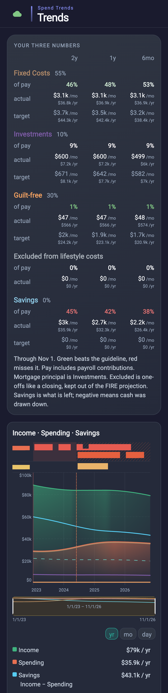

# Spend Trends

Personal **categorical spend trend analysis** for **macOS and iPhone** only. Connect accounts via [SimpleFIN Bridge](https://beta-bridge.simplefin.org/) (or import history), categorize outflows, and read long-term shape per category — not monthly envelope budgeting.

This is a personal app (not a product). The repo is public-safe: bank Access URLs, Setup Tokens, JWT secrets, and LLM tokens live only in a local `.env` (gitignored) and the device keychain — never in git.

### Screenshots



Regenerate from fixtures (skipped in plain `flutter test`):

```bash
flutter test --run-skipped --update-goldens -t readme-screenshot
```

## What it does

- **See whether a category is drifting up or down** — smoothed trailing-year spend lines (total + per category) so long-term shape is readable, not drowned in daily noise.
- **Keep history categorized without babysitting every swipe** — assign a merchant once, add “contains” rules, merge duplicate categories, and optionally let the home-server LLM suggest labels for unknowns.
- **Pull in real bank activity** — connect via SimpleFIN for ongoing sync, or load past exports (Copilot CSV / generic CSV) when you need history a bank connection doesn’t cover.
- **Use the same picture on Mac and iPhone** — local PowerSync store syncs to home-server Postgres so categorization and trends stay shared across devices.

## How it works

```
SimpleFIN Bridge ──HTTP──► App (claim + /accounts)
                              │
                              ▼
              PowerSync DB (spend_trends_powersync.db)
                              │
              ┌───────────────┼───────────────┐
              ▼               ▼               ▼
          Trends UI      Activity UI    Categories UI
                              │
                    ethan_sync ↔ Postgres
                    optional: llm-proxy
```

1. Buy SimpleFIN Bridge (~$15/yr) and create a Setup Token in their UI.
2. Set `POWERSYNC_JWT_SECRET` + `SERVER_HOST_LAN` in `.env` (required), then run the app.
3. In **Settings → Connect**, paste the Setup Token. The app claims an Access URL (`https://user:pass@…/simplefin`), saves it to keychain, and you should also put it in `.env` as `SIMPLEFIN_ACCESS_URL` so it survives reinstall.
4. Sync (or import) loads transactions into PowerSync. Categorization uses sticky merchant → category memory plus explicit rules.
5. Trends charts roll categorized outflows into a trailing 365-day window and smooth for readable lines. Changes upload via PostgREST and download on other devices.

## Code layout

| Dir | Role |
|-----|------|
| `features/shell/` | `MaterialApp` + tab shell |
| `features/trends/` | Smoothed category trend charts (primary tab) |
| `features/*/` | Activity, Categories, Settings UI |
| `domain/` | Models + use cases (ingest, categorize, spend rollups) |
| `services/` | SimpleFIN, PowerSync repos, CSV, LLM, ethan_sync config |
| `providers/` | Riverpod wiring |
| `agent_api/` | Loopback HTTP API for agent categorization audits (macOS) |
| `theme/` | Finance accent overlay (`FinanceColors`); chrome via `ethan_ui` |
| `widgets/`, `util/` | Shared UI/helpers |

## Setup

Sibling path packages (same layout as your other Flutter apps):

- `../ethan_utils`
- `../ethan_sync`
- `../ethan_ui`

```bash
cd ~/code/my-code/Active/Flutter/spend_trends
cp .env.example .env
# Required: POWERSYNC_JWT_SECRET, SERVER_HOST_LAN
# Optional: SIMPLEFIN_ACCESS_URL (after first Connect), LLM_APP_SECRET
flutter pub get
flutter run -d macos
# or
flutter run -d iphone
```

### `.env` keys

| Key | Required | Purpose |
|-----|----------|---------|
| `SERVER_HOST_LAN` | Yes | Home server host |
| `POWERSYNC_JWT_SECRET` | Yes | ethan_sync JWT (raw secret; infra `SPEND_TRENDS_POWERSYNC_JWT_KEY` is its base64url form) |
| `SIMPLEFIN_ACCESS_URL` | After claim | Claimed Access URL (not Setup Token) |
| `LLM_APP_NAME` | Optional | Usually `spend_trends` |
| `LLM_APP_SECRET` | Optional | Must match infra `LLM_SPEND_TRENDS_SECRET` |
| `AGENT_API_TOKEN` | Optional | Turns on the agent API (macOS); any random string |
| `AGENT_API_PORT` | Optional | Agent API port, default `8791` |

`.env` is gitignored and listed as a Flutter asset (same pattern as your other apps). Keep real values only on your machine.

## Agent API

While the macOS app is open, it serves a loopback-only HTTP API on
`127.0.0.1:$AGENT_API_PORT` so a local agent can audit and adjust
categorization. A hot restart can leave that port stuck on a dead listener;
the app then binds a free port and writes the one it serves on to
`~/Library/Application Support/com.ethan.spend_trends/agent_api_port`, which
`scripts/agent_api` reads. Routes call the same repositories and `Categorizer` the UI
uses; writes go through PowerSync and sync to other devices. Every route
except `/health` needs `Authorization: Bearer $AGENT_API_TOKEN`.

```bash
scripts/agent_api GET /context
scripts/agent_api GET '/transactions/totals?groupBy=merchant&area=fixedCosts&since=2026-01-01'
scripts/agent_api POST /transactions/notes '{"query":{"search":"cinco mud","since":"2026-01-01"},"note":"Old house utility","dryRun":true}'
```

Start with `GET /context`. It returns a guide to category roles, rules,
conscious spending areas, lifestyle costs, every category with counts and
trailing-year spend, accounts, and the full endpoint list (the source of
truth; this table is a map).

| Need | Endpoint |
|------|----------|
| Find rows | `GET /transactions` with any of `ids`, `category`, `area`, `account`, `accountKind`, `rule`, `search`, `note`, `hasNote`, `excludedFromLifestyleCosts`, `since`, `until`, `minAmountCents`, `maxAmountCents`, `direction` (lists comma-separated) |
| Total them | `GET /transactions/totals?groupBy=category\|area\|merchant\|account\|accountKind\|month\|rule` plus the same filters |
| Where a window's pay went | `GET /cash-flow?since=&until=`, and `GET /conscious-spending` (the dashboard card) |
| Balance history | `GET /accounts/<id>/balances?every=month\|day` |
| Note many rows | `POST /transactions/notes {ids \| query, note, mode, dryRun}`; re-runs rules once, so a contains rule on the note phrase takes them |
| Rules | `GET /rules?search=&category=`, `POST /rules/plan` (dry run), `POST /rules`, `PATCH`/`DELETE /rules/<id>` |
| Duplicate imports | `GET /duplicates` (preview), `POST /duplicates/remove {linked, sameAccount}` |
| Categories, groups | `GET /categories`, `POST /categories`, `PATCH /categories/<id>`, `POST /categories/<id>/merge`, `POST /groups` |
| Banks, accounts, imports | `POST /banks/pull`, `PATCH /accounts/<id>`, `POST /accounts/manual`, `POST /accounts`, `POST /transactions/import` |
| Empower history | `GET`/`POST /imports/empower`; the pull itself is in [docs/empower_transactions_pull.md](docs/empower_transactions_pull.md) |
| Projections | `GET /projections`, `PATCH /projections/assumptions` |

Writes that delete or rewrite rows take a dry run or preview first; use it.

## Infra

Server schema lives in this repo under `db/` and syncs to `../../infra/spend_trends/` for Docker mounts (PowerSync **8083**, PostgREST **3006**). Register `LLM_SPEND_TRENDS_SECRET` on the shared llm-proxy for category suggestions.

## Icon

Source art: `assets/icon/app_icon.png`. Refresh platform assets with:

```bash
dart run flutter_launcher_icons
```

## Platforms

- **macOS** — primary; sandbox off for keychain + network (see Runner entitlements).
- **iOS** — supported.
- **Android** — not a target (personal Apple-device app).
